# 🌊 Leviathan

**An AI study companion that also launches your career.**
*Feed it your exams. It feeds you a career.*

Leviathan is a full-stack learning platform built for a hackathon. A student uploads their own
course material and learns from it with an AI tutor, a study-aware video feed and quizzes —
then uses the same app to prepare for the first job: search links, a LinkedIn kit, interview
practice and coding challenges. Everything works in **Hebrew, Arabic and English** (full RTL).

> Formerly "Private Tutor + StudyFeed". The StudyFeed tab keeps its name; the project is Leviathan.


### [▶ Live Demo](https://leviathan-demo.netlify.app)

The live demo is the real interface running on **sample data**: there is no database or AI behind it, nothing is saved, uploads are disabled and video playback is replaced by a placeholder. It signs you in automatically, so you can open the Tutor, ask a question, try the exam, and walk through Career Launch (job kit, interview practice, coding challenge). See [Static demo build](#static-demo-build).

| | |
|---|---|
| 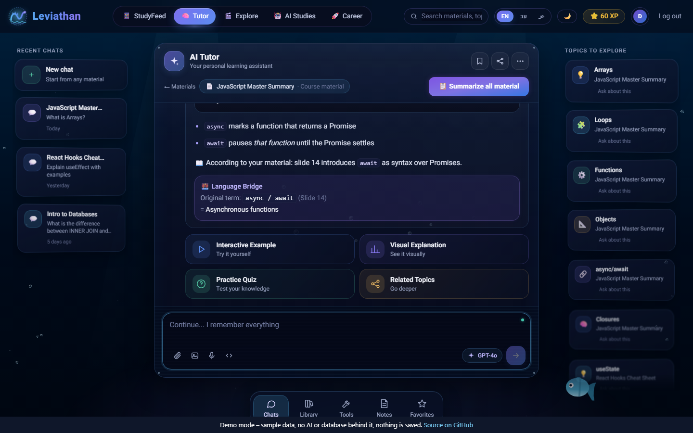 | 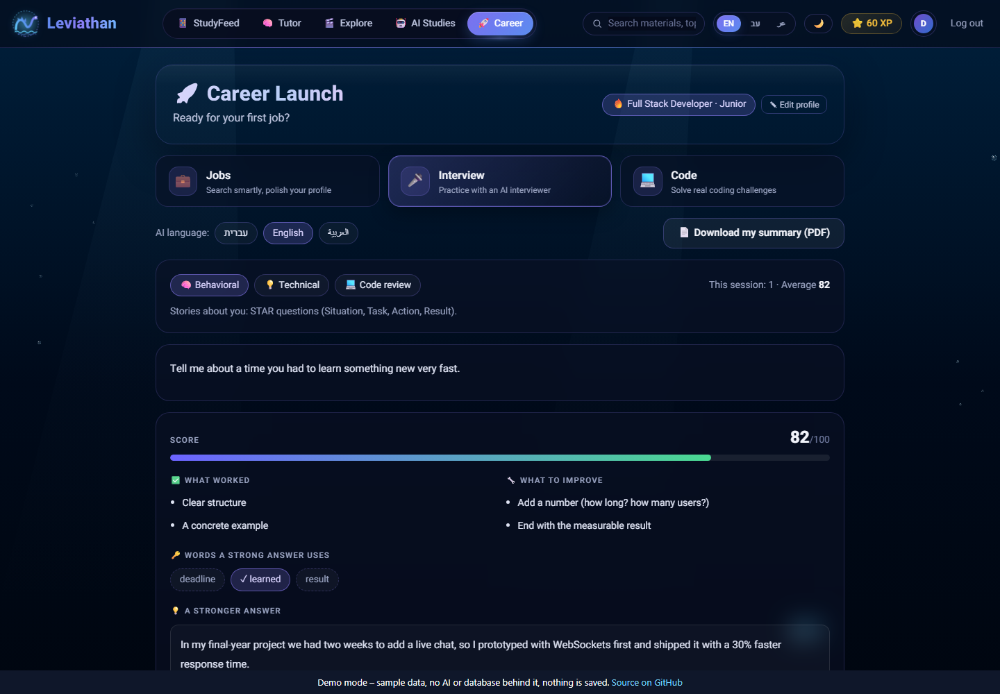 |

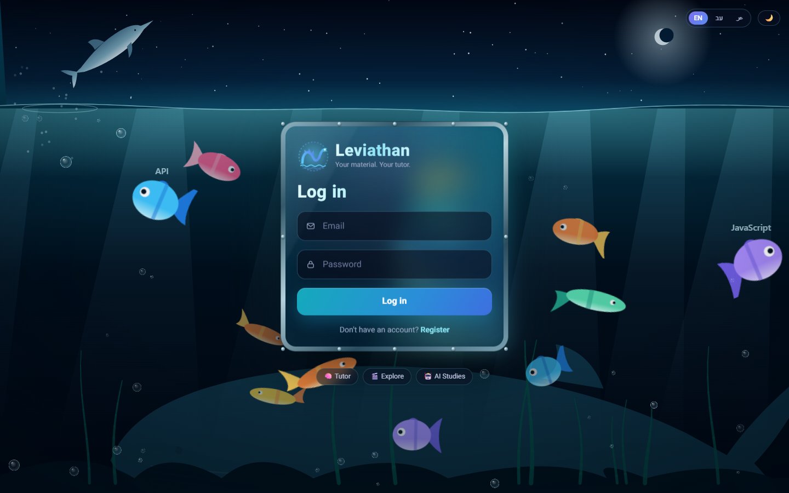

## Contents

1. [Screenshots](#1-screenshots)
2. [What it does](#2-what-it-does)
3. [Run it on your computer](#3-run-it-on-your-computer) ← start here if you downloaded the project
4. [Navigation](#4-navigation)
5. [Tech stack](#5-tech-stack)
6. [Project structure](#6-project-structure)
7. [Database schema](#7-database-schema)
8. [API routes](#8-api-routes)
9. [Team & division of work](#9-team--division-of-work)
10. [Roadmap](#10-roadmap)
11. [Deploy & demo](#11-deploy--demo)
12. [Tests and security notes](#12-tests-and-security-notes)

---

## 1. Screenshots

The screenshots show the real interface with demo data (they were taken with the database and
AI answers replaced by sample responses, so you can see every screen without any accounts).

| | |
|---|---|
| 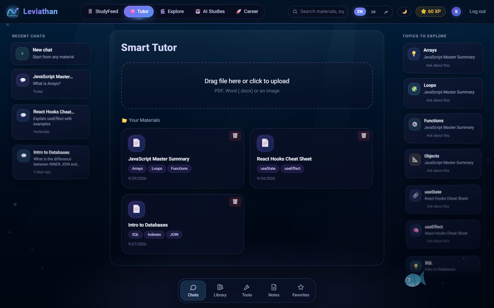 **Smart Tutor** — your materials, saved chats, topics to explore | 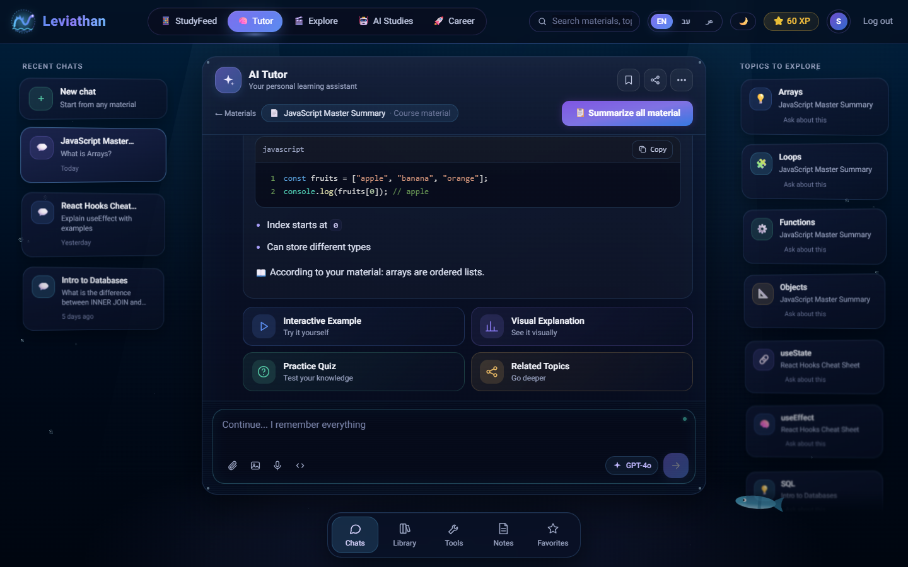 **Tutor chat** — answers from your own material |
| 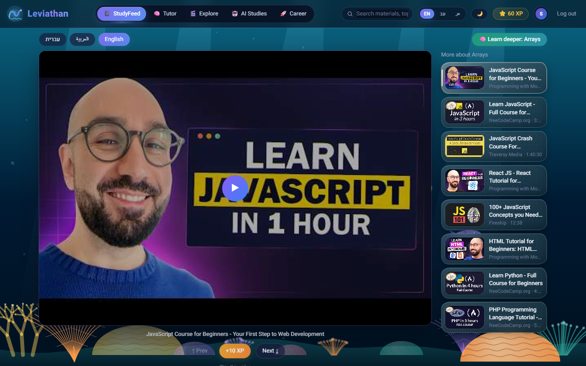 **StudyFeed** — a feed that follows what you study | 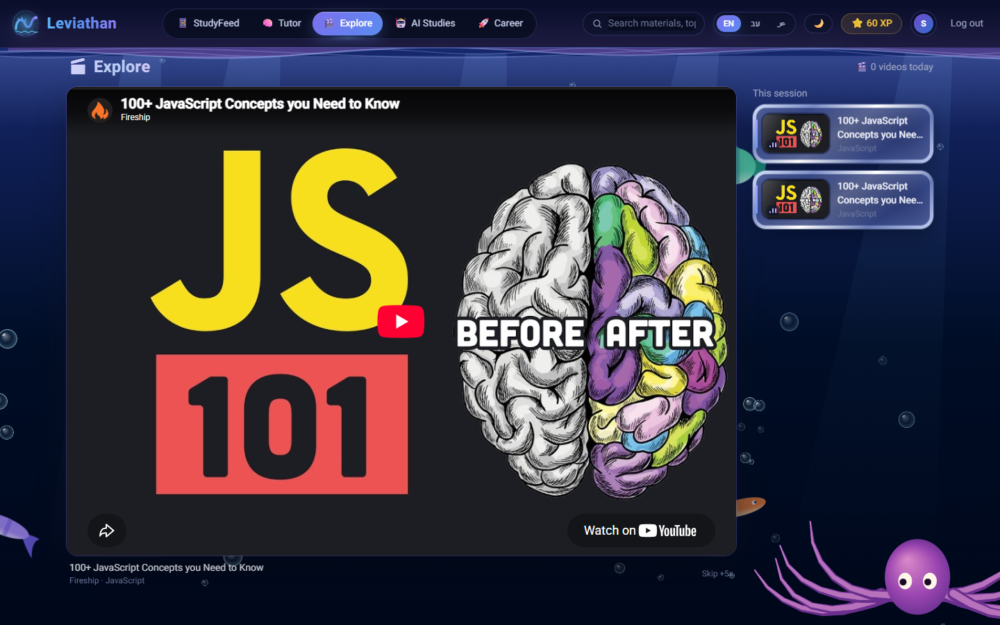 **Explore** — short videos + a quick question for XP |
| 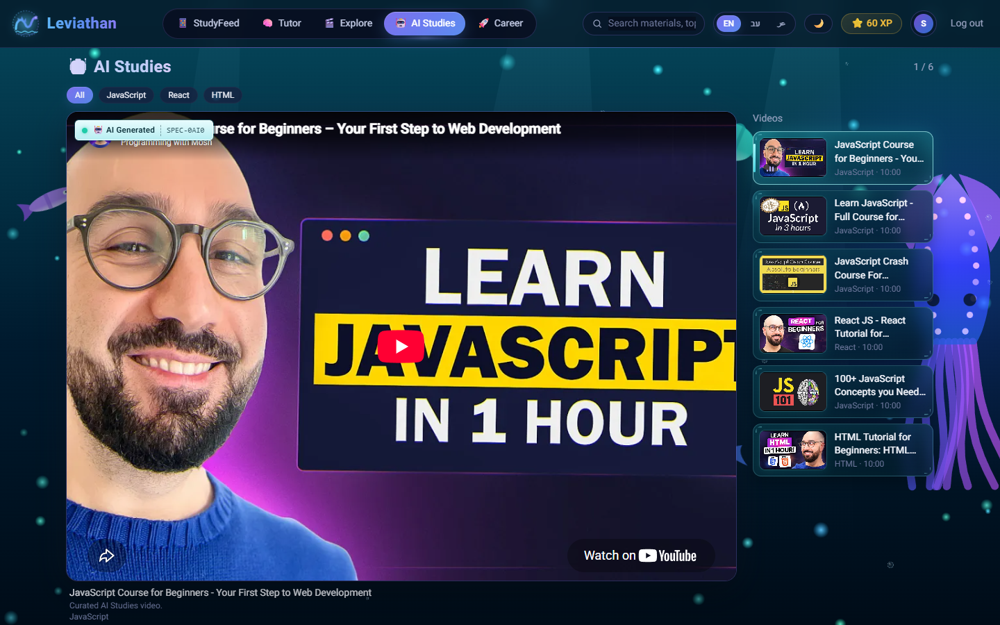 **AI Studies** — curated videos | 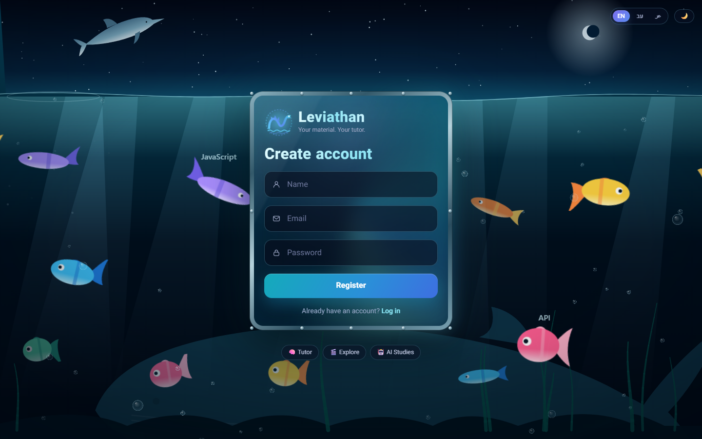 **Register** — the same aquarium, with the Leviathan mark |

### 🚀 Career Launch

| | |
|---|---|
| 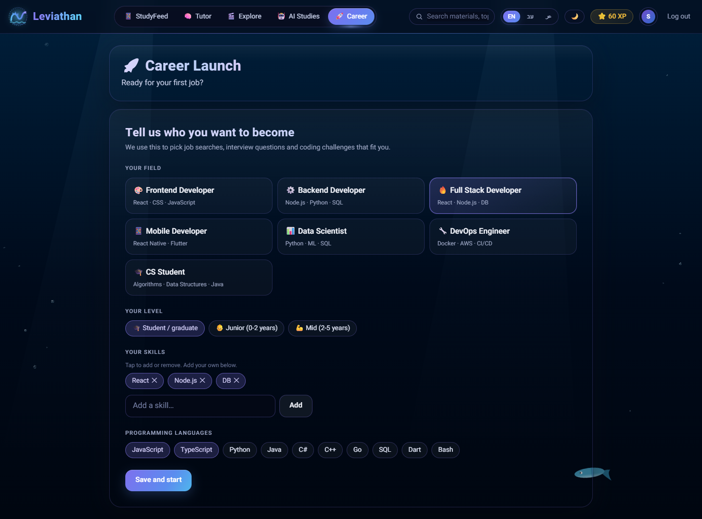 **Profile** — 7 fields, your level, your skills | 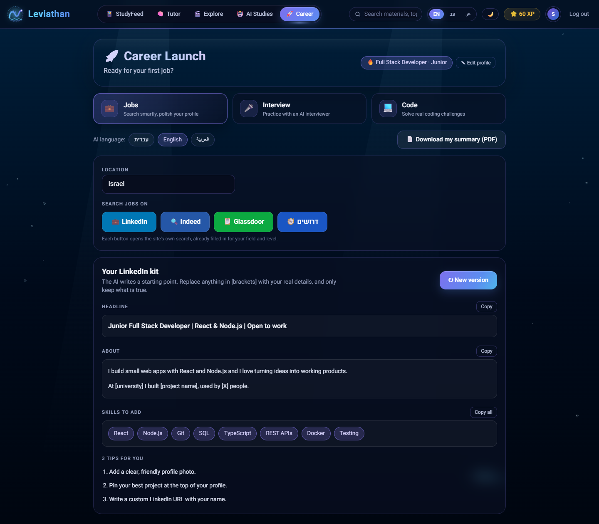 **Jobs** — search links + an AI-written LinkedIn kit |
| 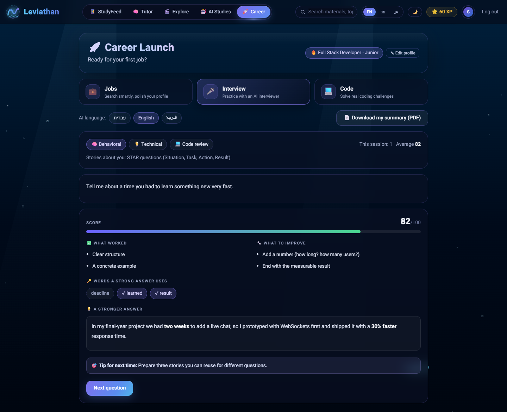 **Interview** — practice questions with scored feedback | 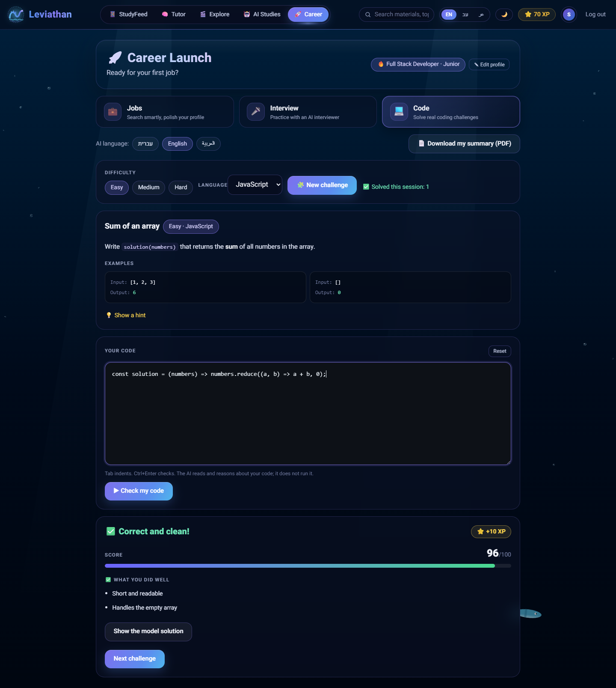 **Code** — AI-written challenges, reviewed for XP |

---

## 2. What it does

### 🧠 Smart Tutor
Upload a lecture (PDF, Word, or a photo of handwriting/a whiteboard). The app extracts the
text, chunks it, and embeds it for retrieval (RAG). Ask "what am I stuck on?" in Hebrew,
Arabic, or English (typos and mixed languages are handled), and the tutor:
- runs a short internal "thinking" pass before answering (Chain of Thought),
- answers **only from your material** when it genuinely explains the topic, and says so
  ("According to your material..."); if the material doesn't cover it, it says exactly that
  and then still gives a full general-knowledge explanation instead of refusing,
- classifies the type of confusion (unknown term / missing prerequisite / general confusion),
- shows a **Language Bridge**: the original term as written in the material, if the material
  is in a different language than the question,
- remembers the whole conversation (multi-turn chat, not a one-shot Q&A),
- generates a professor-style exam question with an Active Recall hint (never reveals the
  answer), grades a free-text answer, and updates a per-topic **Gap Map**; the exam question
  can be translated to Hebrew / English / Arabic with one click,
- **summarizes the entire material** into a structured study sheet that you download as
  **PDF or Word**, in the language you choose (Hebrew, English or Arabic),
- **saves every conversation**: a sidebar lists past chats, reopens one with its full
  history and deletes it from a menu. "Your Materials" is a grid where a material (and, with
  it, its chats and progress) can be deleted, with a confirmation dialog and a toast.

### 📱 StudyFeed
A vertical, full-screen YouTube feed in Hebrew / Arabic / English tabs. It **automatically
re-fills** whenever the topic you're studying in the Tutor changes (shared `activeTopic` state
in Zustand) — a banner explains why the feed just changed. "Learn deeper" sends you back to
the Tutor with that topic pre-filled. Videos that fail to embed are detected and skipped.

### 🎬 Explore
A gamified feed of short (≤ 60 seconds), curated videos across 12 general dev topics
(JavaScript, React, CSS, Git, API, Database, Node.js, HTML, Python, TypeScript, Docker, SQL).
After each video a quick multiple-choice question appears; a correct answer awards XP and
moves to a new random topic, a wrong one keeps the topic with a short AI explanation.

### 🤖 AI Studies
A curated vertical video feed (same look as Explore) that shows only the videos we add to the
`ai_videos` table — each a YouTube embed or a direct video file — with an "AI Generated"
badge. Watching a video to the end earns +5 XP. Videos are added through an admin-only route
(`POST /api/ai-videos/add`, protected by `ADMIN_API_KEY`).

### 🚀 Career Launch
Prepares a student for the **first job**. First a profile (field, level, skills, languages),
then three sections:

| Section | What you get |
|---|---|
| 💼 **Jobs** | 4 search buttons (LinkedIn, Indeed, Glassdoor, Drushim) already filled in for your field, level and location, plus an **AI LinkedIn kit**: a headline, an About section, skills to add and 3 tips — each with a copy button |
| 🎤 **Interview** | Behavioral, technical or code-review questions, a hint, and feedback with a **score**, strengths, what to improve and a stronger version of your answer |
| 💻 **Code** | AI-written challenges (easy / medium / hard) in the language you choose, a plain code editor, and an AI review with a score, the model solution and XP |

Plus a **PDF of everything you practiced** (your profile, interview answers with scores, solved
challenges), in Hebrew, English or Arabic, and an **AI-language picker** (the AI writes in the
language you pick, independent of the site language).

The 7 fields: Frontend, Backend, Full Stack, Mobile, Data, DevOps, CS Student. Levels: Student,
Junior, Mid.

Built with safety in mind: every value from the browser is checked against a whitelist and
length limits; the candidate's text is wrapped so the AI never follows instructions inside it;
coding challenges are **signed on the server** (HMAC) so difficulty and XP can't be forged; XP
is decided on the server, only for a correct answer (score ≥ 70), once per problem. The AI
**reads** the code, it does not run it, and the screen says so.

### 🌊 The Leviathan look
A 2D canvas **aquarium** (fish, coral, light rays, a sea background per tab) runs behind the
app and reacts to login, XP and the current tab. Glass panels, light and dark themes, a
reduced-motion mode, and the animation pauses when the tab is hidden.

**StudyFeed, Explore, AI Studies and the Tutor are never shown at the same time** — one tab at
a time, synced through one shared piece of state.

---

## 3. Run it on your computer

Follow these steps in order. They work on Windows, macOS and Linux.

### 3.1 What you need first

| Need | Why | Where |
|---|---|---|
| **Node.js 18.17 or newer** (20 LTS recommended) and npm | runs the app | https://nodejs.org |
| **Git** | download the project | https://git-scm.com |
| **Google Chrome or Microsoft Edge** | the PDF download uses it locally | already on most computers |
| A free **Supabase** project | database + login | https://supabase.com |
| An **OpenAI API key** (with some credit) | the AI | https://platform.openai.com/api-keys |
| A **YouTube Data API v3 key** | videos | https://console.cloud.google.com → APIs & Services |

Check your versions:

```bash
node -v
npm -v
git --version
```

### 3.2 Download the project

```bash
git clone https://github.com/saeedabuhani/Hackathon-private-tutor.git
cd Hackathon-private-tutor
git checkout devlop
```

(`devlop` is the integration branch with the newest code. Once it is merged, the same code is on
`main` and you can skip the `git checkout` line.)

### 3.3 Install the packages

```bash
npm install
```

### 3.4 Create your `.env.local`

Copy the example file and open the new file in an editor:

```bash
# macOS / Linux / Git Bash
cp .env.example .env.local
```
```powershell
# Windows PowerShell
copy .env.example .env.local
```

Fill in the values:

| Variable | Where to get it |
|---|---|
| `NEXT_PUBLIC_SUPABASE_URL` | Supabase → Project Settings → API → *Project URL* |
| `NEXT_PUBLIC_SUPABASE_ANON_KEY` | the same page → *anon public* key |
| `SUPABASE_SERVICE_ROLE_KEY` | the same page → *service_role* key. **Secret — server only** |
| `OPENAI_API_KEY` | OpenAI → API keys |
| `OPENAI_MODEL` | leave `gpt-4o` |
| `YOUTUBE_API_KEY` | Google Cloud → enable *YouTube Data API v3* → Credentials → API key |
| `ADMIN_API_KEY` | any long random text; protects the admin route. Make one: `node -e "console.log(require('crypto').randomBytes(24).toString('hex'))"` |
| `NEXT_PUBLIC_APP_URL` | leave `http://localhost:3000` |
| `YOUTUBE_REGION` | optional, default `IL` |

> 🔒 `.env.local` holds secrets. It is already in `.gitignore` — **never commit it**, and never
> put real keys in `.env.example`.

### 3.5 Set up the database (once)

1. In Supabase open **SQL Editor → New query**.
2. Paste the whole content of [`supabase/schema.sql`](./supabase/schema.sql) and press **Run**.
3. New query again: paste [`supabase/add-career.sql`](./supabase/add-career.sql) and press **Run**
   (the Career Launch tables).
4. Supabase → **Authentication → Providers → Email**: turn **off** "Confirm email", so a new
   account can log in immediately.

The files `add-explore.sql`, `add-ai-videos.sql` and `add-chat-history.sql` are **only** for a
database created before those features existed; a fresh `schema.sql` already contains them.

### 3.6 Fill the Explore catalog (once)

This searches YouTube and stores short videos per topic (it uses your YouTube quota):

```bash
node scripts/seed-explore.js
```

### 3.7 Start the app

```bash
npm run dev
```

Open **http://localhost:3000**, press **Register**, create an account and you are in.

### 3.8 Optional: add an AI Studies video

```bash
curl -X POST http://localhost:3000/api/ai-videos/add \
  -H "Content-Type: application/json" \
  -H "x-admin-key: YOUR_ADMIN_API_KEY" \
  -d '{"title":"What is RAG?","youtube_id":"VIDEO_ID_OR_URL","language":"en","topic":"RAG"}'
```

### 3.9 Other commands

```bash
npm run lint     # code style check
npm run build    # production build (checks that everything compiles)
npm start        # run the production build (after npm run build)
```

### 3.10 If something goes wrong

| Problem | Fix |
|---|---|
| `Port 3000 is already in use` | close the other server, or run `npm run dev -- -p 3001` |
| A page shows **404** right after editing files | stop the server, delete the `.next` folder, run `npm run dev` again |
| Career page says the tables are missing (503) | run `supabase/add-career.sql` (step 3.5) |
| Login works but nothing saves / "permission denied" | `schema.sql` was not run, or `SUPABASE_SERVICE_ROLE_KEY` is wrong |
| New account can't log in | turn off "Confirm email" (step 3.5, item 4) |
| Answers fail with an OpenAI error | check `OPENAI_API_KEY` and that the account has credit |
| No videos in StudyFeed | check `YOUTUBE_API_KEY`; the daily quota may be used up |
| PDF download fails | install Chrome or Edge, or set `CHROME_PATH` in `.env.local` to its `chrome.exe` / browser path |
| Changed `.env.local` but nothing changed | stop the server and start it again (env is read at start) |

---

## 4. Navigation

```
App
├── Auth: /login, /register (Supabase Auth)
└── (main) — top bar with the Leviathan mark + TabBar, always visible
    ├── 📱 /feed                         StudyFeed
    ├── 🧠 /tutor                        Smart Tutor
    │   ├── /tutor                       material list + upload
    │   └── /tutor/[materialId]          chat (topics list → deep Q&A with history)
    │       ├── /exam                    exam question + Active Recall hint
    │       └── /report                  Gap Map
    ├── 🎬 /explore                      Explore Feed
    ├── 🤖 /ai-studies                   AI Studies (curated videos)
    └── 🚀 /career                       Career Launch (Jobs · Interview · Code)
```

## 5. Tech stack

| Layer | Choice |
|---|---|
| Framework | Next.js 14, App Router, **JavaScript only** (no TypeScript) |
| Styling | Tailwind CSS, CSS variables for the theme, Framer Motion, a 2D canvas aquarium |
| State | Zustand (`activeTopic`, `activeLanguage`, `user`, `xp`, `careerProfile`) |
| Database | Supabase (PostgreSQL + `pgvector`), Row Level Security |
| Auth | Supabase Auth (email/password). The Career, saved-chat and delete routes verify the user's token on the server (see section 8) |
| AI | OpenAI `gpt-4o`, `text-embedding-3-small` |
| Video | YouTube Data API v3 |
| File parsing | `pdf-parse` (PDF), `mammoth` (Word), GPT-4o Vision (images/handwriting) |
| Export | `puppeteer-core` (+ `@sparticuz/chromium-min` on Vercel) for PDF, `docx` for Word |
| Rendering | `react-markdown`, `react-syntax-highlighter` |
| Languages | Hebrew, Arabic, English — `lib/translations.js`, full RTL |
| Deploy | Vercel |

### Architecture

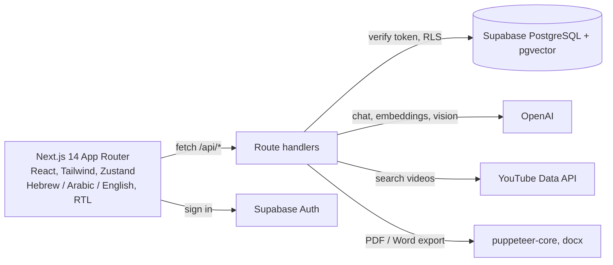

Uploaded material is split into chunks and embedded (`text-embedding-3-small`); a question retrieves the closest chunks, so answers come from **your** material and say so when it does not cover the question.

## 6. Project structure

```
app/
├── (auth)/{login,register}/page.js
├── (main)/
│   ├── layout.js                 top bar + session check
│   ├── feed/page.js              StudyFeed
│   ├── explore/page.js           Explore Feed
│   ├── ai-studies/page.js        AI Studies feed
│   ├── career/page.js            Career Launch (3 tabs)
│   └── tutor/
│       ├── layout.js             conversations sidebar + page
│       ├── page.js               upload + "Your Materials" grid
│       └── [materialId]/         chat, exam/, report/
└── api/                          see section 8

components/
├── layout/      Brand (logo), TopNav, TabBar, XpCounter, HeaderSearch, PreferencesControls
├── aquarium/    AquariumCanvas, SeaBackground, sprites, creatures, scenes/
├── auth/        login/register styles       AuthForm.js (shared by both pages)
├── tutor/       StuckInput (chat), ChatSidebar, MaterialsGrid, ExamCard, GapMap, SummaryButton, ...
├── feed/        VideoFeed, VideoSidebar, VideoControls, FeedSyncBanner, QuickQuestion
├── explore/     ExploreVideo, ExploreQuestion, ExploreExplain
├── ai-studies/  AiVideoPlayer
└── career/      ProfileSetup, JobFinder, InterviewPrep, CodeChallenge, careerText, ui, career.css

hooks/     useFeed, useGapMap
lib/       supabase, openai, embeddings, extract, youtube, youtubePlayer, videoFrame, utils,
           server (shared route helpers), authFetch, translations, summaryPrompt, summaryExport,
           career: careerData (fields, levels, job links), careerAI (prompts + cleaning),
                   careerSign (signed challenges), careerServer (route helpers)
store/     useStore.js (Zustand)
supabase/  schema.sql, add-career.sql (+ add-explore / add-ai-videos / add-chat-history for old DBs)
scripts/   seed-explore.js, vercel-env.ps1
docs/      screenshots/
```

## 7. Database schema

Defined in [`supabase/schema.sql`](./supabase/schema.sql) and [`supabase/add-career.sql`](./supabase/add-career.sql)
(run once in the Supabase SQL Editor — see [3.5](#35-set-up-the-database-once)).

| Table | Purpose |
|---|---|
| `users` | Mirrors `auth.users` (auto-created on signup via trigger); tracks XP |
| `materials` | Uploaded files: extracted text, AI-extracted topics, file type |
| `embeddings` | 500-word chunks of each material + `vector(1536)` embeddings (pgvector) |
| `stuck_points` | Every question asked, its detected language, stuck-type, answer, language bridge |
| `quiz_attempts` | Exam answers, correctness, hint given |
| `gap_map` | Running per-topic score/attempts/stuck-count, per user and material |
| `explore_videos` | Shared catalog of short videos per topic, seeded from YouTube |
| `explore_attempts` | Explore Feed quiz answers per user |
| `chat_sessions` / `chat_messages` | Saved conversations per user and material, and their messages |
| `ai_videos` | Curated AI Studies videos (YouTube id or direct URL), ordered by `order_index` |
| `career_profiles` | One row per user: field, level, skills, programming languages |
| `interview_sessions` | Interview questions asked, the answer, AI feedback and score |
| `code_challenges` | Coding challenges: the problem, the user's code, the review, XP earned |

`match_chunks` (SQL function) does the cosine-similarity vector search behind RAG. Every table
has Row Level Security — each user only ever sees their own rows (`explore_videos` and
`ai_videos` are shared catalogs: readable by everyone, writable only by the service role).

## 8. API routes

| Route | Method | What it does |
|---|---|---|
| `/api/materials` | GET / POST | List materials, or upload one (extract → chunk → embed → topics) |
| `/api/materials/[id]` | DELETE | Delete a material (cascades to its chats, embeddings, progress) |
| `/api/stuck` | POST | Deep, multi-turn RAG chat with Chain-of-Thought and source transparency |
| `/api/exam` | POST | Generate a tricky exam question + Active Recall hint |
| `/api/exam/translate` | POST | Translate an exam question to Hebrew / English / Arabic |
| `/api/hint` | POST | Grade a free-text answer, give a hint (never the answer), update gap map |
| `/api/summary` | POST | Summarize the whole material; returns the summary and, if asked, a PDF or Word file in the chosen language |
| `/api/gap-map` | GET / POST | Read or update per-topic progress |
| `/api/xp` | POST | Add XP to a user |
| `/api/sessions` | GET / POST | List the caller's saved chats, or start one |
| `/api/sessions/[id]` | DELETE | Delete a chat and its messages |
| `/api/sessions/[id]/messages` | GET / POST | Read a chat's messages, or append one |
| `/api/feed` | GET | YouTube videos for a topic, in he/ar/en, filtered for embeddability |
| `/api/feed/question` | POST | Quick multiple-choice question from a video's title/description |
| `/api/explore/videos` | GET | One random, unseen-this-session short video for a topic |
| `/api/explore/question` | POST | Multiple-choice question for an Explore video |
| `/api/explore/answer` | POST | Record the answer, award XP, pick the next topic |
| `/api/ai-videos` | GET | AI Studies videos ordered by `order_index` (`?topic=&lang=`) |
| `/api/ai-videos/add` | POST | **Admin only** (header `x-admin-key`): add a YouTube or direct-file video |
| `/api/career/profile` | GET / POST | Read or save the career profile |
| `/api/career/jobs` | GET | The AI LinkedIn kit (headline, About, skills, tips) for a field and level |
| `/api/career/interview` | POST | Ask an interview question, or score an answer and save the session |
| `/api/career/challenge` | POST | Create a signed coding challenge, or review submitted code and award XP |
| `/api/career/summary` | GET | PDF of everything practiced in Career Launch |

**Who is calling?** The Career routes, the saved-chat routes and the delete routes verify the signed-in user's Supabase token on the server, so the user cannot be faked. The older Tutor, Feed, Explore and XP routes still identify the user by the `userId` the app sends; moving them to token verification is the first security item in [FUTURE.md](./FUTURE.md).

## 9. Team & division of work

Built by a three-person hackathon team (names as listed in the project; to be confirmed by the authors):

| Name | Area | Branch |
|---|---|---|
| **Saeed** | Base: auth, navigation, shared state and libraries, deployment. The Leviathan design (aquarium, login/register, top bar). **Career Launch** (profile, jobs, interview, code, PDF) | `saeed_abo-hani` |
| **Mohammed** | Smart Tutor — upload, RAG chat, saved chats sidebar, exam, hints, summary, gap map | `Mohammed` |
| **Arkan** | StudyFeed, Explore, AI Studies, database schema & seeding | `arkan` |

All work is integrated on `devlop`; `main` gets the tested version last.

## 10. Roadmap

What we plan next — most importantly **Career Launch for every profession, not only software**
(doctors, nurses, teachers, designers, lawyers, accountants, engineers, marketers and more).
The full plan, with status per item, is in **[FUTURE.md](./FUTURE.md)**.

## 11. Deploy & demo

- [DEPLOY.md](./DEPLOY.md) — deploying to Vercel (env variables, Supabase URL, known limits).
- [DEMO.md](./DEMO.md) — the 5-minute demo script and an end-to-end checklist.

### Static demo build

The public demo is built from the same source with no server and no keys:

```bash
npm install
node scripts/build-demo.mjs     # writes the static site to demo-dist/
```

The script copies the project to a temporary folder, removes `app/api`, switches Next.js to `output: "export"` and builds with `NEXT_PUBLIC_DEMO=true`. In that mode `lib/supabase.js` returns a stub client that is always signed in as a demo user, and `lib/demo/install.js` answers every `/api/*` request in the browser from `lib/demo/fixtures.js` and replaces the YouTube player with a placeholder. No API key is ever part of the demo bundle.

## 12. Tests and security notes

**Tests:** there is no automated test suite yet. Verified by hand: `npm run build` succeeds, and the live demo was clicked through with Playwright (tutor chat with Language Bridge, exam, explore, AI Studies, job kit, interview feedback, code challenge) with no console errors.

**Security notes**

- Secrets live in `.env.local` (git-ignored); `.env.example` holds empty placeholders. The full git history was scanned for API keys, JWTs, service-role keys and private keys: none found.
- Career, saved-chat and delete routes verify the caller's Supabase token on the server; the service-role client is used server-side only.
- Row Level Security is enabled on the database tables (see `supabase/schema.sql`).
- The public demo has no back end and contains no credentials.
